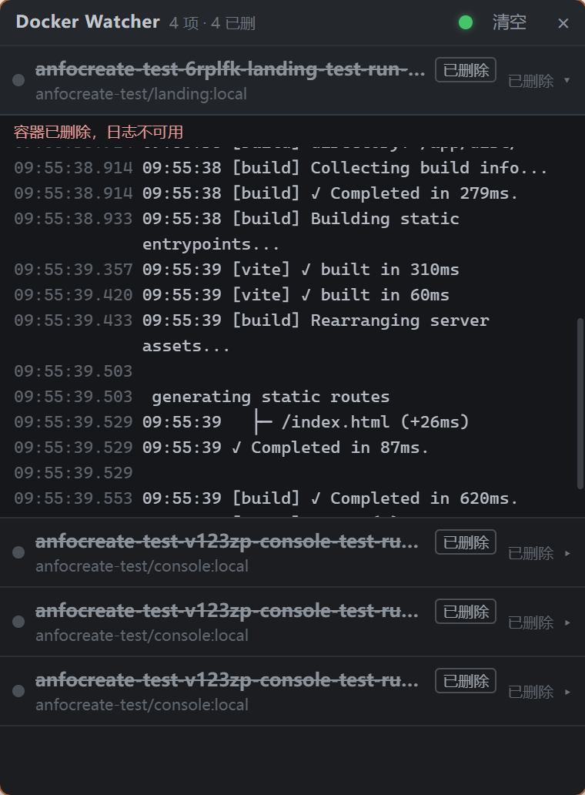

# Docker Watcher

**English** | [简体中文](./README.zh-CN.md)

A Docker container watcher that lives in the system tray: a frameless, always-on-top window
that shows container lifecycle events in real time and lets you read each container's logs
without leaving your desktop.

## Screenshot



## Getting it running

There is no packaged installer in this repository yet, so it is built from source.
Requirements (Node, Rust, Docker Desktop) and packaging are covered in
[AGENTS.md](./AGENTS.md); for everyday use:

```bash
npm install
npm run tauri dev
```

The window opens right away and the tray icon appears with it.

## Using the window

- Frameless and always on top, and kept out of the taskbar. Drag it anywhere by the title
  bar; resize it from any edge (minimum 320×260).
- The dot in the title bar is green while the Docker engine answers and red when it does not
  — hover it to see why.
- The counter next to the title shows how many containers are listed and how many of them have
  been deleted.
- `清空` (Clear) empties the list and the cached logs.
- `×` only hides the window; the app keeps running in the tray.

## Using the tray icon

- **Left-click** shows or hides the window.
- **Right-click** opens the menu: *显示 / 隐藏监听窗口* (Show / Hide window) and *退出* (Quit).
  Only *Quit* ends the process.

## Reading the list

- One row per container, keyed by container id, so nothing is ever listed twice. New
  containers appear at the top and existing rows never move.
- Each row shows the container name, its image, its status and a state dot.
- A removed container is only **marked** as deleted (struck through, `已删除` badge): the row
  and the logs already captured for it stay exactly where they were — the history is not wiped.
- Rows start collapsed; click one to expand its logs.

## Reading the logs

- Expanding a row loads the last 50 lines.
- Scroll to the top of the log pane to load earlier lines: it steps 50 → 200 → 1000 → all and
  keeps the view still. Once everything is loaded it says 已到最顶端 and stops asking.
- `stdout` and `stderr` are colour-coded, and the timestamps come from Docker.
- Colour codes the program itself wrote (ANSI escapes) are rendered as colours rather than
  shown as `[0m[32m` noise, and a line that repaints itself with `\r` is reduced to what a
  terminal would end up showing.
- When logs cannot be read — a container that was removed before the app was watching it — the
  pane says so instead of pretending to be empty.

## Coming back later

The list, the deleted markers and the cached logs are stored on your machine, so closing the
window, restarting the app or rebooting keeps your history. Containers always come back
collapsed.

Containers that were removed while the app was not running are detected on the next start: the
list is reconciled against the containers Docker still knows about, and anything missing is
marked as deleted with its last cached logs kept.
